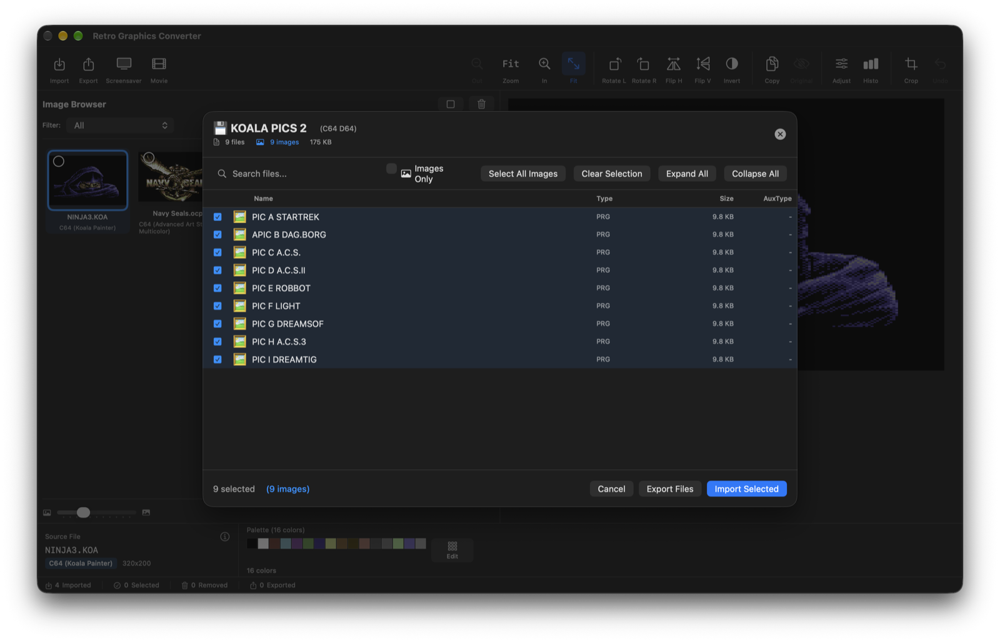
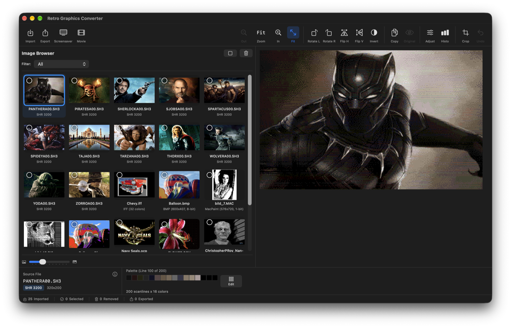
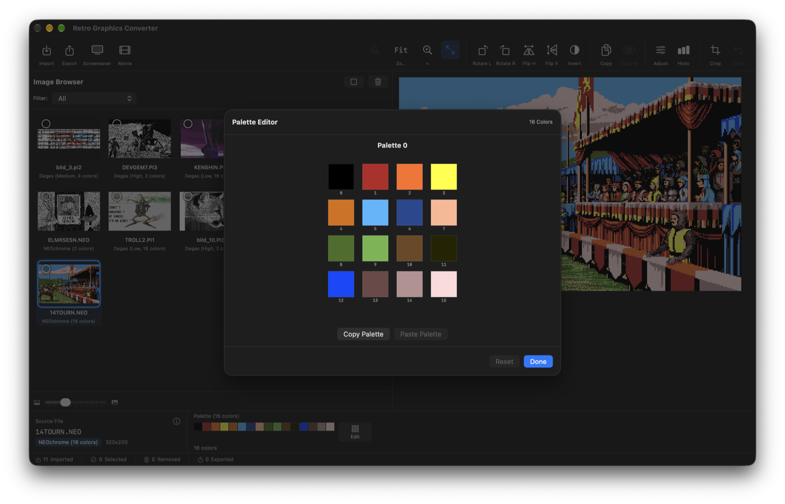
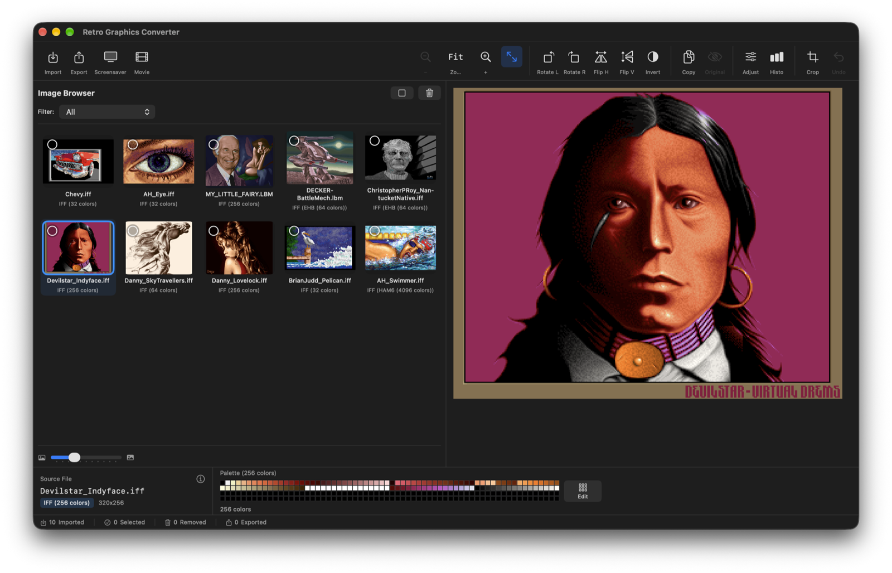
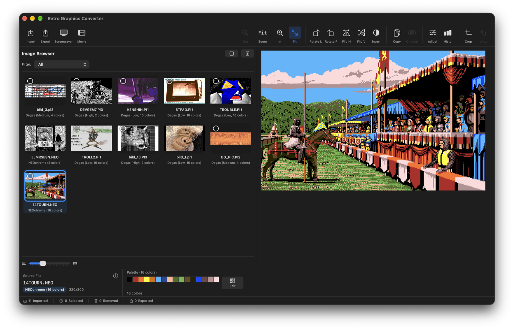
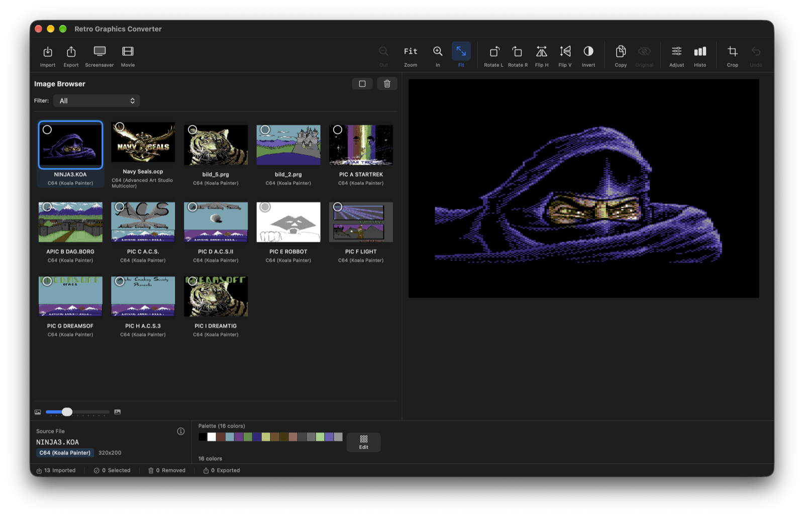
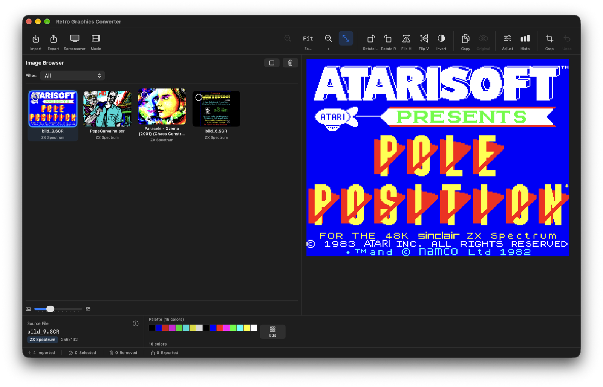
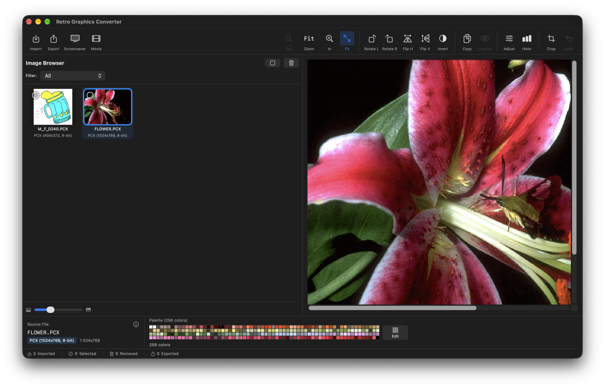
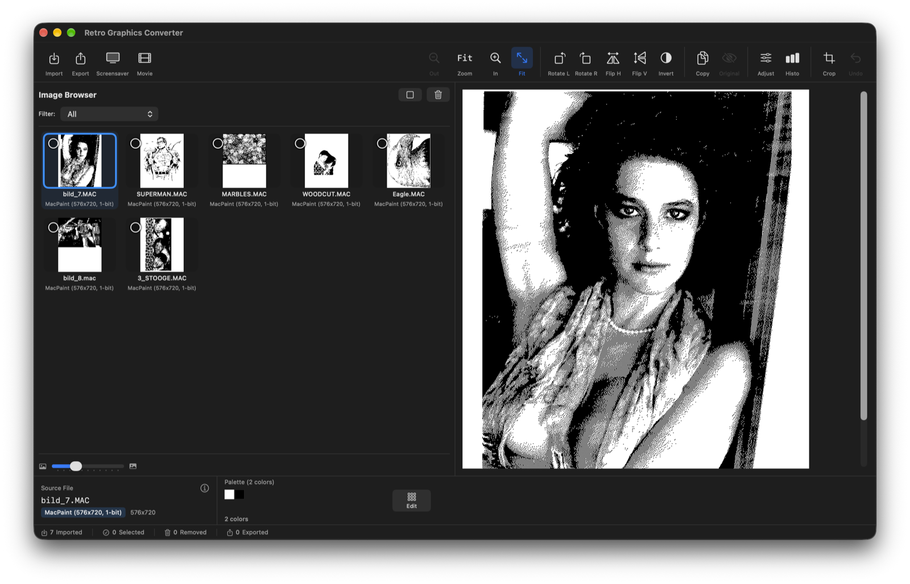
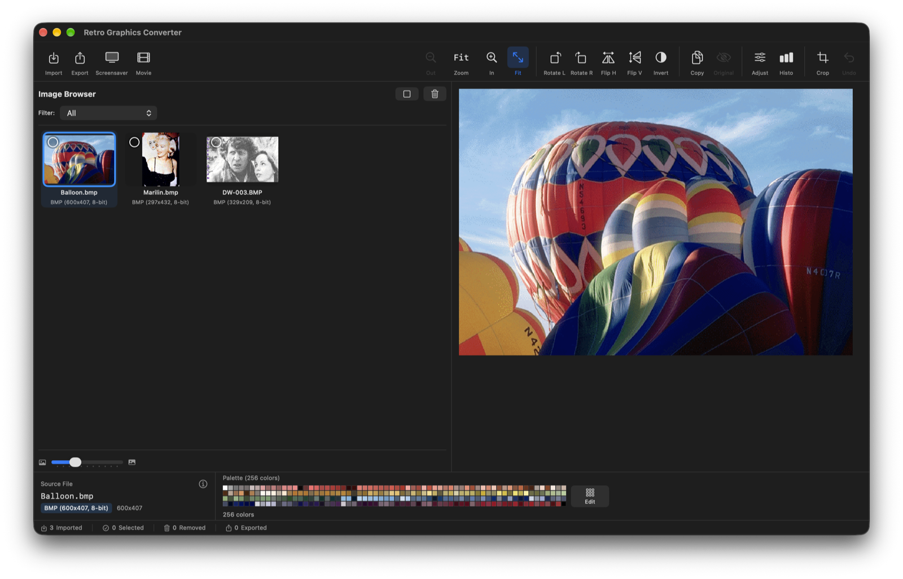

I was in search of a tool for MacOS that could batch convert Apple IIgs SHR graphics into png format but could not find anything.
In the end I decided to code one myself in Swift. It started with SHR uncompressed graphic files to png format.
Then i added HGR and DHGR conversion and output formats like png, jpg, tiff, gif and heic.
Was bored and added then more graphic formats...

Just drag and drop your disk images in the app and extract your pics from there. You also can export any file from within the app to your Mac.

**Get it:** [Mac App Store](https://apps.apple.com/us/app/retro-graphics-converter/id6756440759?mt=12) (ready to run) or free from the [GitHub releases](https://github.com/portwally/Retro-Graphics-converter/releases). Requires macOS 15.6 or later, Apple Silicon or Intel.

**New in 4.5:** a full quality pass - every decoder and disk reader was checked against thousands of real disk images and sample pictures. Keyboard shortcuts, new Atari ST formats (Art Director, GFA Artist, Palette Master, Doodle), D71/D81 and DiskCopy 4.2 disks, palette editing for many more formats, and many fixes. See the [CHANGELOG](CHANGELOG.md) for everything.



📂 Supported Formats (16 Platforms)
Retro Platforms

🍎 Apple II/IIGS: SHR (Standard/3200/3200 Packed/816Paint/DreamGrafix/Paintworks/Apple Preferred Format), PaintWorks animations (first frame), Finder icon files, HGR, DHGR, packed HGR/DHGR, PNT, PIC<br>
🖥️ Amiga: IFF/ILBM (8-bit indexed, Extra-Half-Brite, 24-bit RGB, HAM6 4096 colors, HAM8 262144 colors), ADF disk images<br>
🕹️ Atari ST: Degas (PI1/PI2/PI3), NEOchrome (.NEO), Art Director, GFA Artist, Palette Master (.ART), Doodle (.DOO), ST disk images (.st)<br>
🎰 Atari 8-bit (400/800/XL/XE): GR.8, GR.9, GR.10, GR.11, GR.15/GR.7, MicroIllustrator (.MIC), ATR disk images<br>
💾 Commodore 64: Koala Painter (also packed GG), Doodle (also packed JJ), HIRES, Art Studio, Advanced Art Studio, Hi-Eddi, Hires-Editor, Hi-Pic Creator, Run Paint, Vidcom 64, Picasso 64, Dolphin Ed, Blazing Paddles, Wigmore Artist 64, Image System, Saracen Paint, CDU-Paint, Micro Illustrator, Drazpaint, Amica Paint, Star Painter, plain hires bitmaps, D64/D71/D81 disk images<br>
🎹 Commodore Plus/4: HiRes (320×200), Multicolor (160×200), 128-color TED palette<br>
📺 Commodore VIC-20: HiRes (176×184), Multicolor (88×184), 16-color VIC palette<br>
🎮 ZX Spectrum: SCR (6912 bytes), TRD disk images (TR-DOS Beta Disk Interface)<br>
💻 Amstrad CPC: Mode 0 (16 colors), Mode 1 (4 colors), DSK disk images<br>
📺 MSX/MSX2: Screen 1, 2, 5, 7, 8 (SC2/SC5/SC7/SC8/GRP files, BSAVE format), DSK disk images<br>
📻 BBC Micro: MODE 0, 1, 2, 4, 5 (2/4/16 colors, .bbc/.bbm files, BitPast palette support), SSD/DSD disk images<br>
🖳 TRS-80/CoCo: Model I/III block graphics, CoCo PMODE 1/3/4, CoCo 3 (320×200 16 colors, 640×200 4 colors), DSK disk images<br>
🖨️ PC/DOS: PCX (CGA 4-color, EGA 16-color, EGA 64-color, VGA 256-color, 24-bit RGB with RLE compression)<br>
🪟 Windows: BMP (1/4/8/24/32-bit)<br>
🖼️ Classic Mac: MacPaint (1-bit with PackBits compression)<br>

Modern Formats

📸 PNG: Portable Network Graphics<br>
🎞️ JPEG/JPG: Joint Photographic Experts Group<br>
🎬 GIF: Graphics Interchange Format<br>
📄 TIFF: Tagged Image File Format<br>
📱 HEIC/HEIF: High Efficiency Image Format<br>

💿 Supported Disk Image Formats (15 Types)

| Extension | Platform | Description |
|-----------|----------|-------------|
| **.2mg** | Apple II | 2IMG container format (ProDOS or DOS 3.3 volumes) |
| **.po** | Apple II | ProDOS-order disk image (140KB-32MB) |
| **.do** | Apple II | DOS 3.3-order disk image (140KB) |
| **.dsk** | Apple II / Amstrad CPC / MSX / CoCo | Universal disk format (auto-detected, including DiskCopy 4.2 and double-sided CoCo RS-DOS images) |
| **.hdv** | Apple II | ProDOS hard disk volume (up to 32MB) |
| **.img** | Various | Generic disk image format |
| **.d64** | Commodore 64 | 1541 disk image (170KB, 35 or 40 tracks) |
| **.d71** | Commodore 128 | 1571 disk image (340KB, 70 tracks, double-sided; 80-track images too) |
| **.d81** | Commodore 128 | 1581 disk image (800KB, 80 tracks, 3.5" floppy) |
| **.adf** | Amiga | Amiga Disk File (880KB OFS/FFS) |
| **.st** | Atari ST | Atari ST disk image (360KB-720KB) |
| **.atr** | Atari 8-bit | Atari 400/800/XL/XE disk image (90KB-360KB) |
| **.ssd** | BBC Micro | Single-sided DFS disk (100KB/200KB) |
| **.dsd** | BBC Micro | Double-sided DFS disk (200KB/400KB) |
| **.trd** | ZX Spectrum | TR-DOS disk image (640KB, Beta Disk Interface) |

✨ Features
File Management

📥 Drag & Drop: Drop files anywhere - main area or browser panel<br>
📁 Folder Support: Recursively scan folders for image files<br>
🔄 Batch Processing: Process hundreds of files at once<br>
🔎 Platform Filter: Show only the images of one platform in the browser<br>
💿 Disk Browser: Pick the files to import from a disk image, or export the raw files; several disks open one after another<br>
📂 Recent Folders: Quick access to previously opened folders from File menu<br>

Image Tools

🔄 Rotate: Rotate images 90° left or right<br>
↔️ Flip: Mirror images horizontally or vertically<br>
🔲 Invert: Swap colors (great for MacPaint/1-bit images)<br>
✂️ Crop: Select and crop any region of an image<br>
📋 Copy: Copy current image to clipboard for pasting into other apps<br>
👁️ Before/After: Toggle between original and modified view<br>
↩️ Undo: Revert up to 10 actions (Cmd+Z); a batch transform counts as one<br>
📊 Batch Transform: Apply rotate/flip/invert to all selected images at once<br>
☀️ Adjustments: Brightness and contrast with live preview<br>
📈 Histogram: RGB, single channel and luminance histograms with color count<br>

Palette Editing

🎨 Live Color Editing: Click any palette color to modify it in real-time<br>
🖼️ Supported Formats: SHR (including Apple Preferred Format), 3200-color, C64, Plus/4, VIC-20, Amiga IFF, Atari ST, Atari 8-bit, ZX Spectrum, Amstrad CPC, MSX, BBC Micro, TRS-80/CoCo, MacPaint, and more<br>
📍 Scanline Palettes: Move the mouse over the picture to see the palette of each line (SHR and 3200-color images)<br>
📋 Copy & Paste: Copy a palette and paste it onto another line or picture<br>
🔄 Reset: One-click reset to restore original palette<br>

Export & Conversion

💾 Export Formats: PNG, JPEG, TIFF, GIF, HEIC, or the original retro file<br>
📈 Upscaling: 1x (original), 2x, 4x, 8x with nearest-neighbor (pixel-perfect)<br>
📦 Batch Export: Export the selected images (or all) to one or more formats at once<br>
🛡️ No Overwriting: Images that share a name get a number appended instead of replacing each other<br>
🎨 Format Preservation: Maintains authentic retro look with proper color palettes<br>

Screensaver Export

📺 Create macOS Screensavers: Export your retro graphics as a folder for macOS photo screensavers<br>
🖥️ Auto-Setup: Automatically opens System Settings to configure your screensaver<br>
📏 Scale Options: 2x, 4x, or 8x scaling for crisp pixels on modern displays<br>
📂 Organized Storage: Images saved to ~/Pictures/Retro Screensavers/<br>

Movie Export

🎬 Video Slideshow: Create MP4 or MOV videos from your images<br>
⏱️ Timing Control: Set display duration per image (1-10 seconds)<br>
🔀 Transitions: Crossfade, Fade to Black, Slides, Wipes, Zooms, or Random<br>
📺 Resolution: Export in 720p, 1080p, or 4K<br>
🎥 Codecs: H.264 (universal compatibility) or H.265/HEVC (better quality, smaller files)<br>
📏 Pixel-Perfect: Nearest-neighbor scaling preserves the authentic retro look<br>

User Interface

🔍 Adjustable Thumbnails: Slider to resize preview thumbnails (50-150px)<br>
ℹ️ Image Info: Click info button to see dimensions, file size, color count, format details<br>
📊 Status Bar: Track imported, selected, removed, and exported file counts, plus the latest result or error message<br>
🎛️ Modern Toolbar: Hero-style buttons with icons and labels<br>

Keyboard Shortcuts

| Shortcut | Action |
|----------|--------|
| **Cmd+O** | Import files or folders |
| **Cmd+E** | Export |
| **Cmd+A** | Select all images shown in the browser |
| **Delete** / **Cmd+Delete** | Remove the selected images |
| **Cmd+Z** | Undo |
| **Cmd +** / **Cmd -** / **Cmd 0** | Zoom in / zoom out / fit to window |
| **Arrow keys** | Previous / next image |
| **Home** / **End** | First / last image |

In text fields, Cmd+A and Cmd+Delete edit the text as usual.

Smart Detection

🧠 Intelligent Format Recognition: Magic bytes, file size, and extension analysis<br>
🔬 Multi-Method Detection: Priority system prevents false positives<br>
⚙️ Edge Case Handling: Supports variant file sizes (e.g., C64 Koala 10003-10010 bytes)<br>
🎯 Conflict Resolution: DHGR vs CPC, MacPaint vs SHR detection logic<br>

Technical Highlights

🎨 Accurate Color Palettes: C64, Apple II, EGA, CGA, ZX Spectrum, MSX TMS9918, BBC Micro, CoCo palettes<br>
🗜️ Decompression Support: RLE (PCX), PackBits (MacPaint), PackBytes (PNT/SHR), LZW (DreamGrafix), IFF compression<br>
🔄 Format-Specific Decoding: Planar, chunky, interleaved, tile-based bitmap handling<br>
🎯 Amiga HAM Decoding: Full Hold-And-Modify algorithm for HAM6 (4096 colors) and HAM8 (262144 colors)<br>
📊 Resolution Accuracy: Proper aspect ratios and pixel layouts<br>

🚀 Use Cases

🕰️ Retro Gaming: Convert game graphics from classic platforms<br>
🎨 Digital Preservation: Archive vintage computer art<br>
🔄 Format Migration: Batch convert old formats to modern standards<br>
📚 Collection Management: Browse and organize retro graphics libraries<br>
🖼️ Comparison: View retro and modern images side-by-side<br>
💿 Archive Processing: Extract and convert graphics from 15 disk image formats (.2mg, .po, .do, .dsk, .hdv, .img, .d64, .d71, .d81, .adf, .st, .atr, .ssd, .dsd, .trd)<br>
📺 Screensavers: Turn your retro art collection into a beautiful macOS screensaver<br>
🎬 Video Slideshows: Create movies from your graphics with transitions for sharing or presentations<br>


Apple IIgs 3200-color pictures from a ProDOS hard disk image, together with pictures from other platforms


Palette editor: a 3200-color Apple IIgs picture has its own 16-color palette on each of its 200 lines


Amiga IFF: 32 and 256 colors, Extra-Half-Brite and HAM


Atari ST: Degas PI1, PI2, PI3 and NEOchrome


C64: Koala Painter and Advanced Art Studio, imported from a D64 disk


ZX Spectrum SCR


PCX


MacPaint


BMP



IMPORTANT INSTALLATION NOTE (Apple Gatekeeper) - GitHub download only

The App Store version installs and opens normally. The builds on GitHub are not notarized, so macOS might display a security warning upon the first launch.

You may see a message stating: "The app cannot be opened because it is from an unverified developer."

How to bypass this warning (one-time process):

Close the warning window.
Go to the app in Finder (e.g., in your Applications Folder).
Hold the Control key and click on the app icon (or use the Right-Click menu).
Select Open from the context menu.
In the subsequent dialog box, confirm that you want to open the app by clicking Open again.
The application will now launch and will be trusted by macOS for all future starts.
If this does not work then
1. Open Terminal
You can find it in:
Applications → Utilities → Terminal
2. Run the following command (in case you installed it in the Applications directory):<br>
```xattr -cr /Applications/Retro-Graphics-Converter.app```


[](https://github.com/portwally/Retro-Graphics-converter/releases)
[](https://github.com/portwally/Retro-Graphics-converter/stargazers)
[](https://github.com/portwally/Retro-Graphics-converter/network/members)

---

Apple II, Apple IIgs and Macintosh are trademarks of Apple Inc. Amiga, Commodore 64, Atari ST, ZX Spectrum, Amstrad CPC, MSX, BBC Micro, TRS-80 and other names are trademarks of their respective owners. Retro Graphics Converter is an independent app and is not affiliated with or endorsed by any of them.
